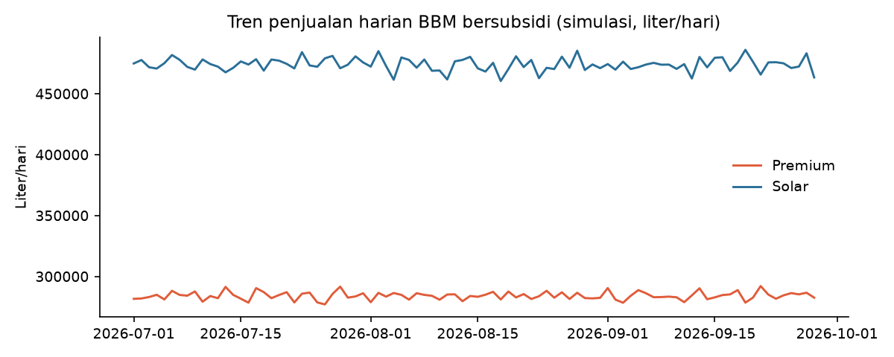
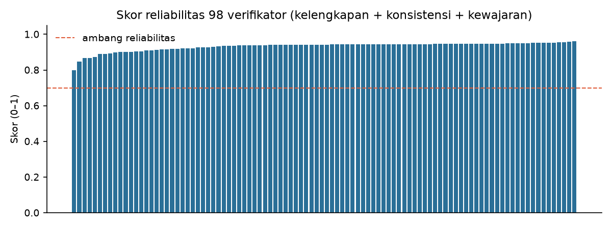
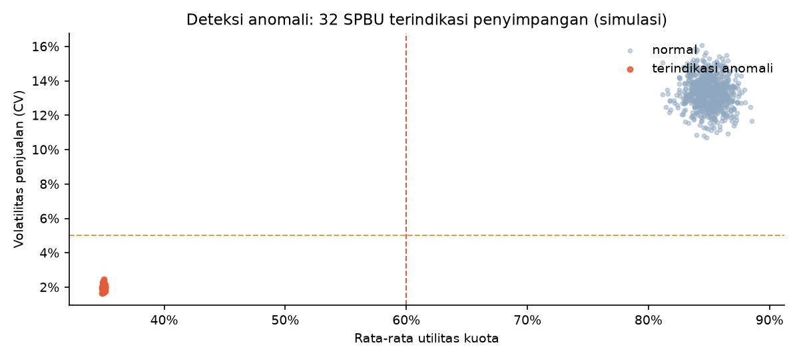

# ⛽ Dashboard Simulasi Pengawasan Distribusi BBM Bersubsidi

Simulasi end-to-end pekerjaan **Analis Pengawal Energi (BPH Migas)**: dari laporan inspeksi lapangan
yang kotor hingga laporan eksekutif siap presentasi. Proyek ini membangun "meja kerja mini" pengawas
distribusi BBM bersubsidi — bukan demo machine learning, melainkan alur kerja analisis yang sesungguhnya:
**data lapangan → validasi & konsolidasi → analisis temuan → laporan keputusan.**



## Apa yang proyek ini tunjukkan

| Lapisan | Meniru tugas resmi | Yang dikerjakan |
|---|---|---|
| **1. Simulasi data lapangan** | Memahami konteks pengawasan | Generator 74.160 laporan inspeksi dari 400 SPBU × 98 verifikator × 90 hari, lengkap dengan noise nyata: laporan ganda, kolom kosong, salah satuan (hektoliter vs liter), laporan terlambat |
| **2. Validasi & konsolidasi** | "Memvalidasi dan mengkonsolidasikan data lapangan", "memantau kualitas pelaporan" | Pembersihan duplikat & satuan, **skor reliabilitas verifikator** (kelengkapan 60% + konsistensi 25% + kewajaran 15%) |
| **3. Analisis & deteksi anomali** | "Melakukan analisis data kinerja penyaluran & pendistribusian BBM" | Utilitas kuota per wilayah/produk, deteksi anomali rule-based yang audit-friendly, **Isolation Forest** sebagai pembanding, evaluasi presisi/recall terhadap ground truth |
| **4. Laporan & dashboard** | "Menyusun laporan hasil evaluasi" | Dashboard Streamlit berbahasa Indonesia + laporan eksekutif otomatis (Markdown & PDF satu halaman) |



## Hasil utama simulasi

- **32 dari 400 SPBU (8,0%) terindikasi penyimpangan** — utilitas kuota ~35% (jauh di bawah ambang 60%),
  pola penjualan flat (CV < 5%), dan klaim stok habis >90% hari.
- Deteksi **rule-based mencapai presisi 100% dan recall 100%** terhadap ground truth simulasi;
  Isolation Forest mencapai presisi 80% / recall 100% — aturan eksplisit lebih cocok untuk konteks
  pengawasan yang harus bisa dipertanggungjawabkan.
- Skor reliabilitas verifikator membedakan kualitas pelaporan tanpa menghukum kelangkaan:
  semua verifikator di atas ambang 0,70, dengan peringkat bawah yang jelas untuk pembinaan.



## Cara menjalankan

```bash
# 1. Siapkan environment (Python 3.10+)
python -m venv .venv
.venv/Scripts/python.exe -m pip install -r requirements.txt   # Windows
# source .venv/bin/activate && pip install -r requirements.txt  # Linux/Mac

# 2. Jalankan pipeline berurutan (dari folder proyek)
.venv/Scripts/python.exe -m src.generate_data    # generator data sintetis
.venv/Scripts/python.exe -m src.validate_data    # validasi + skor verifikator
.venv/Scripts/python.exe -m src.analyze          # analisis + deteksi anomali
.venv/Scripts/python.exe -m src.report           # laporan eksekutif (MD + PDF)
.venv/Scripts/python.exe -m src.make_assets      # grafik untuk README

# 3. Buka dashboard
.venv/Scripts/python.exe -m streamlit run src/dashboard.py
```

## Struktur proyek

```
├── src/
│   ├── config.py          # Semua asumsi bisnis & ambang batas dalam satu file (mudah diaudit)
│   ├── generate_data.py   # Generator data sintetis + injeksi noise & pola anomali berlabel
│   ├── validate_data.py   # Dedup, koreksi satuan, skor reliabilitas verifikator
│   ├── analyze.py         # Fitur SPBU, aturan anomali, Isolation Forest, evaluasi deteksi
│   ├── report.py          # Laporan eksekutif otomatis (Markdown + PDF via ReportLab)
│   ├── make_assets.py     # Grafik statis untuk README
│   └── dashboard.py       # Dashboard Streamlit 4 halaman
├── data/
│   ├── raw/               # Laporan inspeksi "kotor" apa adanya
│   └── processed/         # Data bersih, skor, temuan, metrik evaluasi
├── reports/               # laporan_eksekutif.md + laporan_eksekutif.pdf
├── assets/                # Grafik untuk README
└── tests/                 # 33 test: unit (generator/validasi/analisis), integrasi pipeline, dashboard AppTest
```

## Menguji

```bash
.venv/Scripts/python.exe -m pytest tests/
```

Suite mencakup 33 test: sifat data sintetis (duplikat selalu menandai salinan, rate keterlambatan
mendekati config, seed deterministik), aturan validasi & skor verifikator, aturan deteksi anomali
plus evaluasi presisi/recall, integrasi keempat modul pipeline pada dataset kecil, dan dashboard
Streamlit dijalankan penuh via `AppTest` tanpa browser.

## Kejujuran metodologi

**Seluruh data adalah simulasi.** Ground truth anomali sengaja ditanamkan agar lapisan validasi dan
deteksi bisa dievaluasi secara terukur (presisi/recall). Business logic digali dari pemberitaan publik
BPH Migas/Pertamina — kuota harian SPBU, kelompok Premium & Solar bersubsidi, skema verifikasi lapangan —
sedangkan semua angka adalah asumsi yang terdokumentasi di [`src/config.py`](src/config.py). Ketika data
resmi tidak tersedia, menganalisis data simulasi dengan asumsi eksplisit jauh lebih bermanfaat daripada
tidak menganalisis sama sekali — itulah cara kerja analis yang baik.

## Teknologi

Python · pandas · NumPy · scikit-learn (Isolation Forest) · Plotly · Streamlit · Matplotlib · ReportLab · pytest
